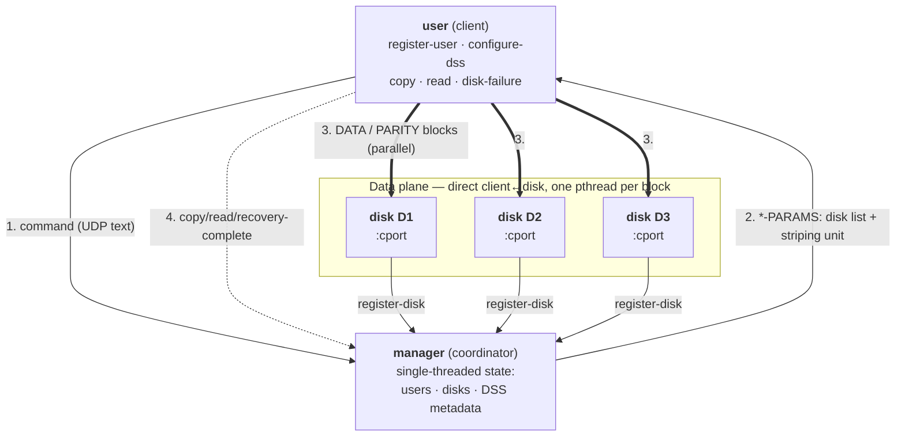
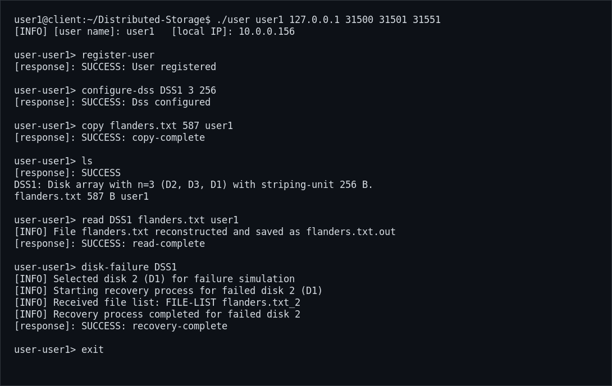
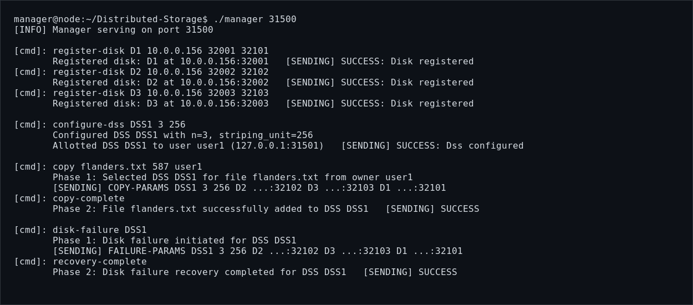
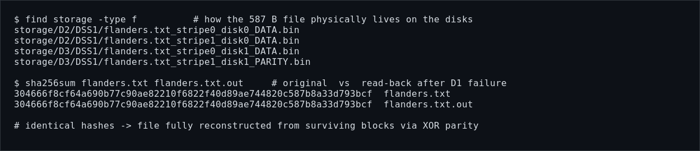

# Distributed Storage System (RAID over UDP)

A fault-tolerant **distributed storage system** written in C for ASU **CSE 434 — Computer Networks**.
Files are split into fixed-size blocks, striped across a pool of independent *disk* nodes with
**rotating XOR parity** (RAID‑5 style), and served over UDP through a small custom text control
protocol. Any single disk in a storage array can fail and its data is rebuilt from the surviving
blocks — with no loss.

- **Three programs:** a `manager` (coordinator), `disk` nodes (block servers), and a `user` client.
- **Transport:** UDP sockets, a plain‑text control protocol, and a two‑phase request/commit pattern.
- **Parallelism:** the client fans block I/O out across disks with **one POSIX thread per block**.
- **Fault tolerance:** `disk-failure` simulates a dead disk and reconstructs it via XOR parity.

> Verified end‑to‑end on localhost: a file copied into a 3‑disk array is read back **byte‑identical
> (matching SHA‑256)** after one disk is failed and recovered — see [Demo](#demo).

---

## Contents
- [Architecture](#architecture)
- [How striping & parity work](#how-striping--parity-work)
- [Components](#components)
- [Build](#build)
- [Quick start](#quick-start)
- [Command reference](#command-reference)
- [Control protocol](#control-protocol)
- [Demo](#demo)
- [On‑disk block layout](#on-disk-block-layout)
- [Project layout](#project-layout)
- [Notes & limitations](#notes--limitations)

---

## Architecture

The **manager** is the control plane: it is single‑threaded and holds all shared state (registered
users, registered disks, and configured storage systems) so there are no data races on that state.
The **user** client talks to the manager only to *coordinate* an operation; the actual block
transfers happen **directly between the client and the disks**, in parallel.



A **DSS** ("Distributed Storage System") is one logical array of `n` disks with a chosen
**striping unit** (block size). The manager can manage several independent DSSs at once.

## How striping & parity work

A file is cut into **stripes**. Each stripe holds `n-1` data blocks plus **1 parity block**, one
block per disk. The parity block is the XOR of that stripe's data blocks, and **which disk holds the
parity rotates from one stripe to the next** (so parity load is spread across all disks — RAID‑5):

```
            disk a        disk b        disk c
stripe 0    data          data          PARITY   = data_a ⊕ data_b
stripe 1    data          PARITY         data     = data_a ⊕ data_c   (parity rotated)
stripe 2    PARITY        data           data     = data_b ⊕ data_c
...
```

Because every stripe is fully determined by any `n-1` of its `n` blocks, losing **one** disk loses
at most one block per stripe — and each missing block is recomputed as the XOR of the survivors:

```
lost_block = block_1 ⊕ block_2 ⊕ … ⊕ block_(n-1)
```

That is exactly what `disk-failure` does: it drops one disk from the array and rebuilds every block
that lived on it, reading the surviving blocks from the other disks in parallel.

## Components

| Program | Role | Threading | Ports (argv) |
|---|---|---|---|
| `manager` | Central coordinator. Registers users/disks, configures DSSs, and drives every operation as a two‑phase transaction. Single source of truth. | Single‑threaded (by design) | `<manager-port>` |
| `disk` | A storage node. Registers with the manager, then stores and serves raw data/parity blocks on its own filesystem. | Listener thread for block I/O | `<name> <mgr-ip> <mgr-port> <mport> <cport>` |
| `user` | The client. Drives `copy` / `read` / `disk-failure`, striping and reconstructing files, talking to disks directly. | One thread **per block** for parallel I/O | `<name> <mgr-ip> <mgr-port> <mport> <cport>` |

`mport` = management port (faces the manager); `cport` = command/data port (faces peers).

## Build

Requires `gcc`, `make`, and a POSIX system (Linux). No external libraries.

```bash
make            # builds: manager, disk, user   (gcc -Wall -Wextra -O3)
make debug      # same, with -O0 -ggdb
make clean
```

## Quick start

Run each program in its **own terminal** (all on `127.0.0.1` here; ports are arbitrary but must match).

**1 — Manager**
```bash
./manager 31500
```

**2, 3, 4 — Three disks** (type `register-disk` at each disk's prompt after it starts)
```bash
./disk D1 127.0.0.1 31500 32001 32101     # then: register-disk
./disk D2 127.0.0.1 31500 32002 32102     # then: register-disk
./disk D3 127.0.0.1 31500 32003 32103     # then: register-disk
```

**5 — User client**
```bash
./user user1 127.0.0.1 31500 31501 31551
```
Then, at the `user-user1>` prompt:
```text
register-user
configure-dss DSS1 3 256          # array named DSS1: n=3 disks, 256-byte striping unit
cp sample/in-flanders.txt flanders.txt   # (in another shell) put a file in the working dir
copy flanders.txt 587 user1       # copy <file> <size-in-bytes> <owner>
ls
read DSS1 flanders.txt user1      # reconstructs to flanders.txt.out
disk-failure DSS1                 # fail one disk, rebuild its blocks via XOR parity
ls
exit
```

> The file passed to `copy` is read from the client's **current working directory**, and `read`
> writes the reconstructed file next to it as `<file>.out`. Sample texts live in `sample/`.

## Command reference

**User client** (`user-<name>>` prompt):

| Command | Meaning |
|---|---|
| `register-user` | Register this client with the manager. |
| `configure-dss <name> <n> <striping-unit>` | Create a storage array of `n` free disks with the given block size. |
| `copy <file> <file-size> <owner>` | Stripe a local file (with parity) across the owner's DSS. |
| `read <dss> <file> <user>` | Fetch and reassemble a file into `<file>.out`. |
| `disk-failure <dss>` | Simulate one disk dying and recover its blocks via parity. |
| `decommission-dss <dss>` | Tear down a DSS and release its disks. |
| `ls` | List configured DSSs and the files they hold. |
| `deregister-user` / `exit` | Leave / quit. |

**Disk node** (its own prompt): `register-disk`, `deregister-disk`.

## Control protocol

Every data operation is a **two‑phase transaction** against the manager, which keeps shared state
consistent and refuses conflicting operations while one is in flight:

1. **Phase 1 — coordinate.** The client sends the command (e.g. `copy …`). The manager validates it
   and replies with a `*-PARAMS` message carrying the disk list, ports, and striping unit:
   - `COPY-PARAMS <dss> <n> <unit> <disk ip cport> …`
   - `READ-PARAMS <dss> <n> <unit> <file-size> <disk …> …`
   - `FAILURE-PARAMS <dss> <n> <unit> <disk …> …`
2. **Phase 2 — act, then commit.** The client performs the block I/O **directly with the disks**
   (in parallel), then tells the manager it finished with `copy-complete` / `read-complete` /
   `recovery-complete`, which commits the state change.

All control messages are human‑readable text over UDP; responses are prefixed `SUCCESS` / `FAILURE: …`.

## Demo

A full session captured on localhost (3 disks, one 587‑byte file, one simulated disk failure).

**Client — the whole workflow:**



**Manager — the coordinator's view of the two‑phase protocol:**



**Verification — physical striping on the disks, and byte‑identical recovery:**



The file is stored as `DATA`/`PARITY` block files spread across the disks, and after disk **D1** is
failed and rebuilt, the read‑back copy has the **same SHA‑256** as the original.

## On‑disk block layout

Each disk persists the raw blocks it owns under a per‑disk, per‑DSS directory:

```
storage/<disk>/<dss>/<file>_stripe<i>_disk<j>_<DATA|PARITY>.bin
```

For the demo above (`DSS1`, 256‑byte unit, 587‑byte file → 2 stripes):

```
storage/D2/DSS1/flanders.txt_stripe0_disk0_DATA.bin
storage/D2/DSS1/flanders.txt_stripe1_disk0_DATA.bin
storage/D3/DSS1/flanders.txt_stripe0_disk1_DATA.bin
storage/D3/DSS1/flanders.txt_stripe1_disk1_PARITY.bin
```

## Project layout

```
manager.c / manager.h   Coordinator: state, registration, two-phase operations
disk.c    / disk.h       Storage node: block persistence + listener thread
user.c    / user.h       Client: striping, parity, parallel block I/O, recovery
logging.h                LOG_INFO / WARN / DEBUG / ERROR macros
Makefile                 build (manager, disk, user)
sample/                  sample text files to copy
docs/                    screenshots used in this README
```

## Notes & limitations

- **Course / educational project.** Designed to run locally (all nodes on `127.0.0.1` in testing).
- **Single‑parity:** an array tolerates **one** disk failure per DSS (RAID‑5 semantics), not two.
- **UDP:** the control protocol is text‑over‑UDP with explicit `*-complete` acknowledgements; it is
  not hardened against arbitrary packet loss, reordering, or adversarial input.
- **Fixed capacities:** compile‑time limits (max users/disks/DSSs/files) are set in the headers.

---

*Built for CSE 434 (Computer Networks), Arizona State University.*
